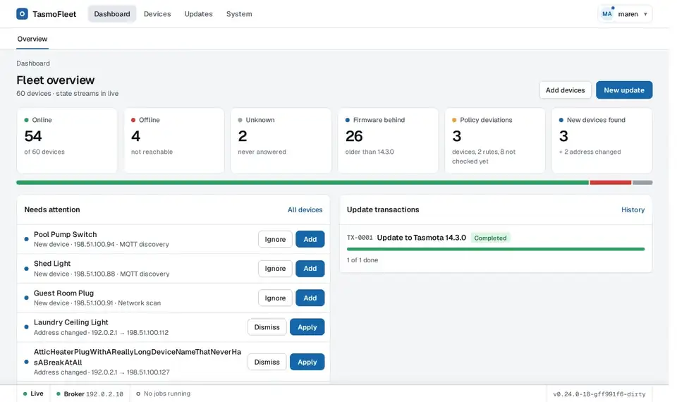
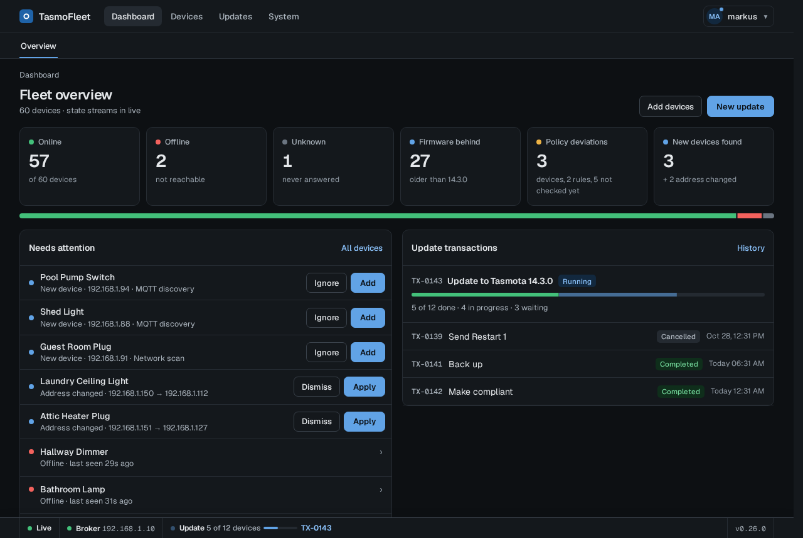
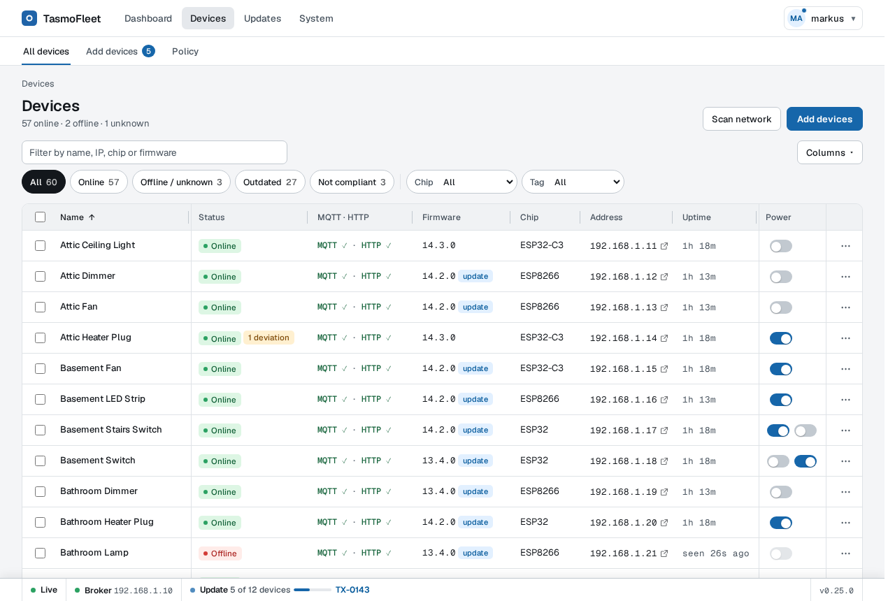
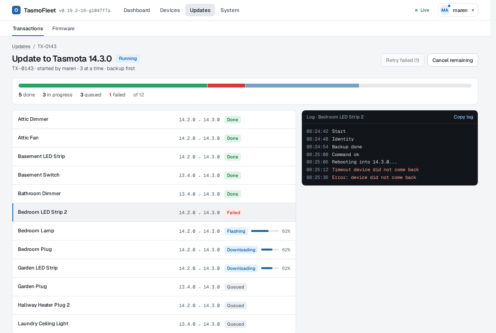
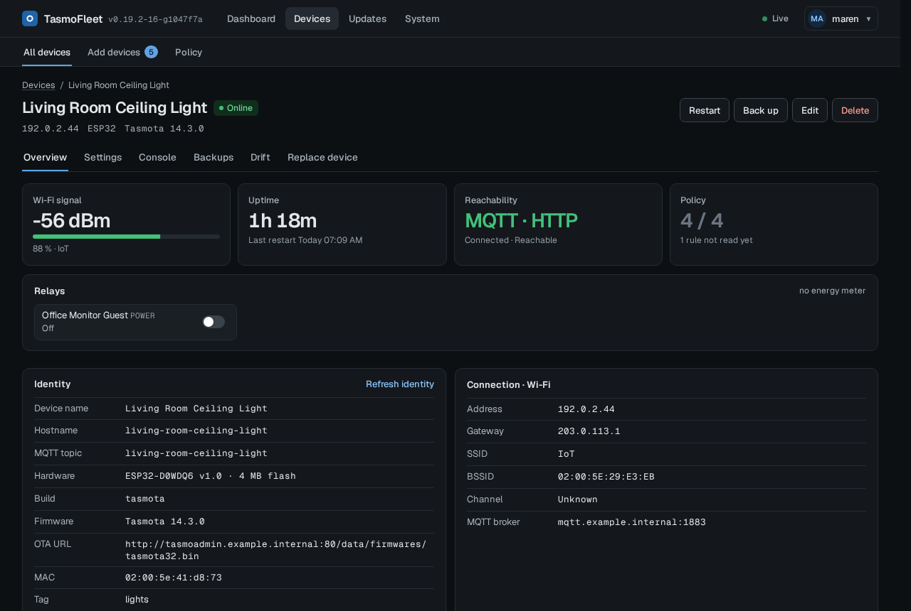

<p align="center">
  <picture>
    <source media="(prefers-color-scheme: dark)" srcset="assets/branding/wordmark-dark.svg">
    
  </picture>
</p>

# TasmoFleet

A self-hosted fleet manager for [Tasmota](https://tasmota.github.io/) devices: configuration
backups with restore, a settings policy with compliance view, safe bulk firmware updates, live state
and fleet-wide commands in one Go binary with an embedded SQLite database.

[](https://github.com/nofuturekid/tasmofleet/actions/workflows/ci.yml)
[](https://github.com/nofuturekid/tasmofleet/releases)
[](LICENSE)
[](https://github.com/nofuturekid/tasmofleet/pkgs/container/tasmofleet)



**[Try the demo](https://nofuturekid.github.io/tasmofleet/)**: the real UI with a simulated fleet
of 60 devices, saved as static pages (actions are disabled).

TasmoFleet is an independent project and is not affiliated with, endorsed by or sponsored
by Tasmota or its maintainers. "Tasmota" is the name of the firmware this tool manages; the
TasmoFleet logo is original and unrelated to the Tasmota logo.

## Why

TasmoFleet is an alternative to [TasmoAdmin](https://github.com/TasmoAdmin/TasmoAdmin),
built on a home fleet of a few dozen devices. What it does differently:

- **Backups with diff and restore**: the raw `.dmp` plus decoded JSON (with
  [decode-config](https://github.com/tasmota/decode-config), bundled in the image), scheduled
  and before every update, compared side by side, restored onto the same or a replacement device.
- **Policy and compliance**: rules such as `PowerOnState 0` or `TelePeriod 300` per chip family,
  tag or device, a drift view per device, and "make compliant" as a transaction.
- **Updates run on the server**, as a persisted job per device (backup, OTA URL, upgrade,
  wait for the reboot, verify), with bounded parallelism. Closing the browser does not stop an
  update, and an update interrupted by a restart resumes. TasmoAdmin drives updates from the
  open browser tab.
- **A safety guard before every `OtaUrl` and `Upgrade`**: it refuses unknown hardware, an image
  whose chip family does not match the device (checked against the image header and the file
  name), safeboot images, and a variant change you did not choose explicitly. 1 MB ESP8266
  devices go through `tasmota-minimal` first.
- **Live state over MQTT** (optional): online state, power and telemetry arrive as they happen
  and the pages update without reloading. Without MQTT every feature works over HTTP polling.
- **Bulk actions as transactions with logs**: updates, commands, backups and policy fixes on
  many devices run as one transaction, with a log per device, cancel and retry of the failed ones.
- **Sign-in** with OIDC single sign-on, trusted forward-auth headers, or local accounts; roles
  (admin, operator) and an audit log of every change.
- **Import from TasmoAdmin**: `devices.csv` and `MyConfig.json`, in the UI or with
  `tasmofleet import tasmoadmin`.

## Features

- **Inventory and discovery**: devices found via MQTT announcements or an HTTP scan of your
  device networks are proposed, not added silently; address changes are detected.
- **Firmware** from upstream (GitHub releases, ota.tasmota.com) or your own uploads, cached,
  checked by its image header and served to devices over plain HTTP from a separate port.
- **Device pages**: overview, power control, console with a command policy, settings, backups,
  drift, state and transaction history.
- **Notifications** of finished updates and failed backups by webhook (e.g. a Home Assistant
  webhook trigger) or e-mail (Resend API).
- **Prometheus metrics** and an example Grafana dashboard ([deploy/](deploy/)).
- Light and dark theme, phone layout, works behind a reverse proxy under a base path.
- Automation stays in Home Assistant (or wherever you run it): TasmoFleet manages devices, it
  does not switch them on schedules.

### What TasmoFleet changes on your devices

Nothing on its own. Everything TasmoFleet does in the background only reads: status polling
(single `Status N` queries, never `Status 0`), the policy live check, scheduled backups (config
download and status snapshot), and discovery (MQTT announcements, HTTP scan).

A device is only changed when someone starts an action in the UI: a firmware update, "make
compliant" for the policy, a console or bulk command, a power toggle, a restart, a restore or a
settings edit. Each of these is recorded in the audit log.

There is no read-only mode or view-only role yet: both roles can change devices. Admins can do
everything; operators can run updates, backups, power toggles, restarts and the allowlisted
commands, but cannot edit the inventory, restore backups, manage firmware, edit or fix policy,
edit settings or manage users.

| Dashboard                                                                                | Device list                                                                   |
| ---------------------------------------------------------------------------------------- | ----------------------------------------------------------------------------- |
|  |  |
| **Running update transaction**                                                           | **Device page (dark theme)**                                                  |
|                     |               |

All screenshots show simulated devices.

## Quick start (Docker)

```sh
docker run -d --name tasmofleet \
  -p 8443:8080 -p 80:80 \
  -e TZ=Europe/Berlin \
  -v tasmofleet-data:/data \
  ghcr.io/nofuturekid/tasmofleet:latest
docker logs tasmofleet 2>&1 | grep -o '/setup/account?token=[^"]*'
```

The image is published to two registries under the same tags: `ghcr.io/nofuturekid/tasmofleet`
and `nofuturekid/tasmofleet` on Docker Hub. Use either name.

The UI always listens on container port 8080; `8443:8080` is the host port you pick. Upgrading
from 0.16 or older with a `-p 8443:8443` mapping? Read [Upgrading to 0.17](docs/upgrading.md) first.

Open `https://<host>:8443` followed by the printed `/setup/account?token=...` path, accept the
self-signed certificate, set the admin password and follow the setup. The link is valid until
the admin has a password; each start prints a fresh one until then.

Port 80 serves firmware to the devices (they fetch it over plain HTTP); it can be any port the
devices can reach. Set the URL the devices use (e.g. `http://<host-ip>`) on the System settings
page; until then firmware updates are off.

The same with Docker Compose:

```yaml
services:
  tasmofleet:
    image: ghcr.io/nofuturekid/tasmofleet:latest
    container_name: tasmofleet
    restart: unless-stopped
    ports:
      - "8443:8080" # UI (HTTPS, self-signed; container port is always 8080)
      - "80:80" # firmware for the devices (plain HTTP)
    environment:
      TZ: "Europe/Berlin" # local time instead of UTC (logs, times the app formats)
    volumes:
      - tasmofleet-data:/data
volumes:
  tasmofleet-data:
```

The container runs as UID 65532. A named volume (as above) works out of the box. For a bind
mount (`-v /srv/tasmofleet:/data`) make the directory writable for that user first, otherwise
Docker creates it as root and TasmoFleet refuses to start with `data dir /data is not writable`:

```sh
mkdir -p /srv/tasmofleet && chown -R 65532:65532 /srv/tasmofleet
```

Alternatively set an explicit `user: "<uid>:<gid>"` in Compose (or `--user`) that owns the
directory. Set `TZ` (e.g. `Europe/Berlin`) to get local time instead of UTC
([what it changes](docs/configuration.md#time-zone)).

With Compose, the setup link is in `docker compose logs tasmofleet`.

**Unraid**: a template is in [deploy/unraid/tasmofleet.xml](deploy/unraid/tasmofleet.xml) (copy
it to `/boot/config/plugins/dockerMan/templates-user/`); it runs plain HTTP behind a reverse
proxy with its own IP on `br0` (UI on port 8080, firmware on port 80 of that IP). The Community
Applications template uses the `bridge` network instead, with the port mappings as the only
place for ports. Upgrading an existing install: [docs/upgrading.md](docs/upgrading.md).

## Configuration

The environment only holds bootstrap settings (listeners, data directory, trusted proxies,
sign-in mode); everything else, single sign-on included, is set in the UI and stored in the
database. A value set in the environment locks its field in the UI.

- **Every environment variable** (purpose, default, bootstrap/lock/legacy, secrets and `_FILE`, how TLS is
  chosen, the time zone): [docs/configuration.md](docs/configuration.md). An example env file:
  [deploy/unraid/tasmofleet.env.example](deploy/unraid/tasmofleet.env.example)
- Reverse proxy, OIDC (Authentik), Prometheus, Grafana and Unraid examples: [deploy/](deploy/).
  Behind a reverse proxy, set `TASMOFLEET_TRUSTED_PROXIES` and `TASMOFLEET_PUBLIC_URL`: the
  same container port 8080 then serves plain HTTP.
- Lost passwords and emergency access: [docs/runbooks/emergency-access.md](docs/runbooks/emergency-access.md)

## Status

**Pre-1.0, single maintainer.** It runs a home fleet of a few dozen devices every
day, but breaking changes are to be expected before 1.0: read the [CHANGELOG.md](CHANGELOG.md) before updating.
Your data is migrated forward; configuration and routes may change. Questions and ideas are
welcome in [Discussions](https://github.com/nofuturekid/tasmofleet/discussions), bug reports in
the [issues](https://github.com/nofuturekid/tasmofleet/issues).

## Documentation

- Design and behaviour: [docs/spec/2026-10-18-tasmofleet-design.md](docs/spec/2026-10-18-tasmofleet-design.md)
- Security notes per feature: [docs/security/](docs/security/)
- Research (Tasmota OTA behaviour, TasmoAdmin lessons): [docs/research/](docs/research/)
- Roadmap: [ROADMAP.md](ROADMAP.md)

## Development

```sh
make check   # templ, fmt, vet, staticcheck, golangci-lint, unit and integration tests, govulncheck, build
make ci      # everything CI runs: check plus race, mutation and e2e tests
make demo    # the static demo (dist/demo); make demo-media renews docs/media
```

Building the image yourself: a plain `docker build` has no git history, so it reports
`<last release>+dev`. Pass the version to get the release and the commit:
`docker build --build-arg VERSION=$(git describe --tags) -t tasmofleet .` (for example
`v0.15.2-3-gabc1234`). `make image` does this.

Requires Go 1.27. The e2e tests need Node.js (`make e2e-deps`, then
`npx playwright install chromium` once). See [CONTRIBUTING.md](CONTRIBUTING.md) and
[CLAUDE.md](CLAUDE.md) (rules for AI agents and humans).

## How it is built (AI disclosure)

TasmoFleet is built with [Claude Code](https://claude.com/claude-code): most code, tests and
docs were written by it. The maintainer sets direction, reviews the changes and tests them on a
real fleet of Tasmota devices. The safety-critical parts (firmware selection, the OTA state
machine) run under mutation testing in addition to unit, integration and Playwright tests
against a device simulator.

## License

[GNU Affero General Public License v3.0 or later](LICENSE) (`AGPL-3.0-or-later`). If you
run a modified version as a network service, you must offer its source to its users; the
About page links to the source code. Third-party notices are in [NOTICE](NOTICE).
